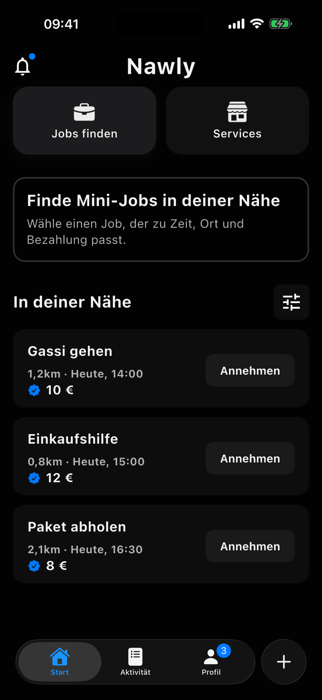
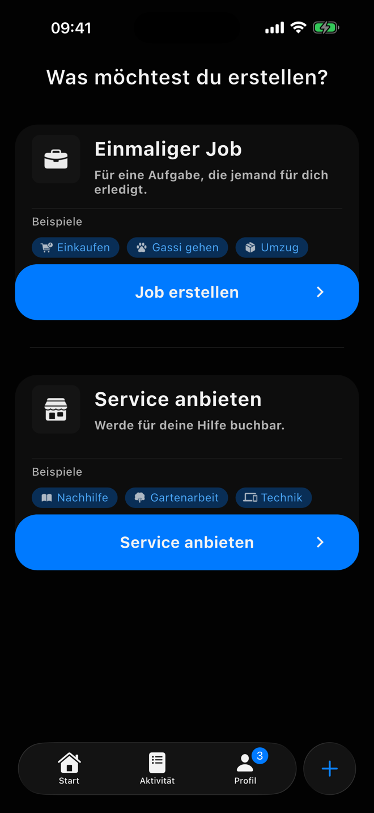
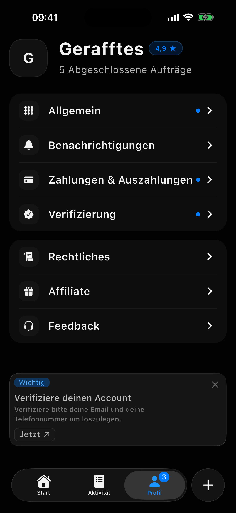

# Nawly

Mit Nawly findest du schnelle Hilfe in deiner Naehe oder verdienst Geld mit kleinen Jobs und Services. Erstelle Aufgaben, buche Services oder hilf anderen direkt vor Ort.

## Idee

Viele Menschen brauchen im Alltag kurzfristig Hilfe. Gleichzeitig gibt es viele Personen, die flexibel kleine Aufgaben übernehmen und sich etwas dazuverdienen möchten.

Nawly bringt beide Seiten zusammen. Über die App können Mini-Jobs in der Umgebung gefunden, erstellt und angenommen werden.

---

## Lösung

Nawly bietet eine einfache Plattform für lokale Mini-Jobs. Nutzer können Aufgaben einstellen, passende Jobs in ihrer Nähe entdecken und direkt darauf reagieren.

Ein wichtiger Bestandteil ist dabei die legale und transparente Buchung von Haushaltshilfen im Privathaushalt. Für entsprechende Tätigkeiten kann Nawly auf das [Haushaltsscheckverfahren der Minijob-Zentrale](https://www.minijob-zentrale.de/DE/fuer-haushalte/vorteile-fuer-haushalte) hinweisen und den Ablauf verständlich in die App integrieren.

Dadurch können private Haushalte Haushaltshilfen offiziell anmelden und rechtssicher beschäftigen. Gleichzeitig entsteht ein finanzieller Vorteil: Laut [Minijob-Zentrale](https://www.minijob-zentrale.de/DE/fuer-haushalte/vorteile-fuer-haushalte) können private Haushalte bei angemeldeter Haushaltshilfe 20 % der entstandenen Kosten, höchstens 510 € pro Jahr, direkt von der Steuerschuld abziehen.

Für die App bedeutet das: Nawly kann nicht nur spontane Hilfe vermitteln, sondern auch dabei unterstützen, Mini-Jobs im Haushalt legal zu organisieren.

---

## Hauptseiten

| Start | Erstellen |
| --- | --- |
|  |  |

| Aktivitaet | Profil |
| --- | --- |
|  |  |
