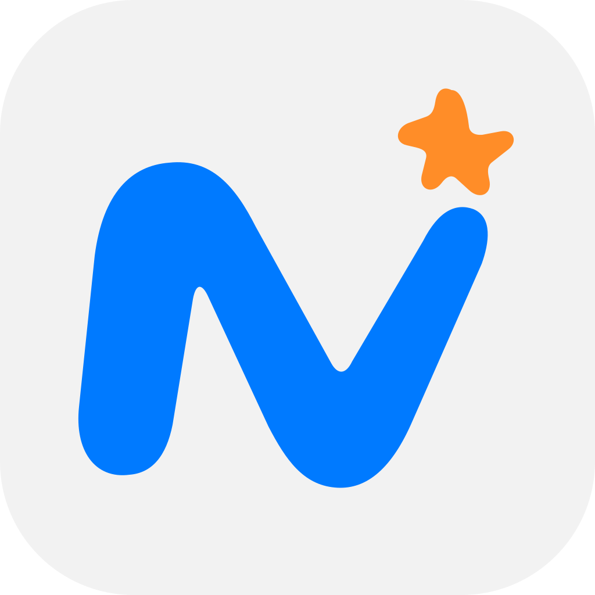

<p align="center">
  
</p>

<h1 align="center">Nawly</h1>

<p align="center">
  Finde Hilfe in deiner Nähe oder verdiene Geld mit kleinen Jobs und Services.<br>
  Lokal, direkt und unkompliziert.
</p>

<p align="center">
  <a href="#was-ist-nawly">Über Nawly</a> ·
  <a href="#funktionen">Funktionen</a> ·
  <a href="#screenshots">Screenshots</a> ·
  <a href="#lokal-starten">Lokal starten</a> ·
  <a href="#status">Status</a>
</p>

<p align="center">
  
  
</p>

<p align="center">
  
</p>

## Was ist Nawly?

Nawly bringt Menschen zusammen, die im Alltag kurzfristig Hilfe brauchen, und Menschen, die kleine Jobs oder Services anbieten möchten.

Über die App sollen Aufgaben in der Umgebung gefunden, erstellt und angenommen werden. Die aktuelle Version konzentriert sich auf den mobilen Flow, die Informationsarchitektur und eine realistische Demo mit lokalen Daten.

Für Haushaltshilfen soll Nawly den Weg zur legalen Organisation verständlicher machen und auf das [Haushaltsscheckverfahren der Minijob-Zentrale](https://www.minijob-zentrale.de/DE/fuer-haushalte/vorteile-fuer-haushalte) verweisen. Rechtliche und steuerliche Angaben müssen vor einem produktiven Einsatz anhand der aktuellen offiziellen Informationen geprüft werden.

## Funktionen

- **Jobs in deiner Nähe:** Demo-Jobs zeigen Titel, Zeitpunkt, Vergütung, Entfernung und Verifizierungsstatus.
- **Jobs und Services erstellen:** Auswahl zwischen einem einmaligen Job und einem eigenen Service mit passenden Beispielen.
- **Aktivitäten verfolgen:** Laufende und abgeschlossene Aktivitäten werden gruppiert und mit Status, Fortschritt und Details dargestellt.

## Screenshots

| Start | Erstellen |
| --- | --- |
|  |  |

| Aktivität | Profil |
| --- | --- |
|  |  |

[Weitere Ansichten ansehen](docs/bilder/weitere/)

## Lokal starten

Eine öffentliche Demo oder Store-Version gibt es aktuell nicht. Nawly läuft im momentanen Stand lokal als Flutter-App mit Demo-Daten.

### Voraussetzungen

- Flutter mit Dart SDK `>=3.9.2 <4.0.0`
- Für iOS: Xcode und ein iOS-Gerät oder Simulator
- Das lokale Paket `mjn_liquid_ui` unter `../packages/mjn_liquid_ui`, da `pubspec.yaml` aktuell einen lokalen Dependency-Override verwendet

### Ausführen

```bash
flutter pub get
flutter run
```

### Prüfen

```bash
flutter analyze
flutter test
```

## Technischer Aufbau

- `lib/main.dart` enthält den App-Shell, die Tab-Navigation, Theme-Unterstützung und die Übergänge zwischen Haupt- und Detailansichten.
- Die Demo-Repositories laden Jobs, Aktivitäten und Profildaten aus [lokalen JSON-Assets](assets/data/).
- `shared_preferences` speichert lokale Einstellungen wie das Theme und den Zustand von Aktivitäts-Erinnerungen.
- `mjn_liquid_ui` liefert die Apple-inspirierten Tab-Bar-, Sheet- und Toast-Bausteine; ergänzende UI- und Skalierungslogik liegt im Projekt selbst.
- Das iOS-App-Icon ist als [Test1_Icon.icon](Icon/Test1_Icon.icon/) eingebunden. Die README-Vorschau liegt unter [docs/assets/readme/test1-icon-preview.svg](docs/assets/readme/test1-icon-preview.svg).

## Status

Nawly ist aktuell ein **Work in Progress** und sollte als interaktiver UI-Prototyp verstanden werden.

### Im aktuellen Checkout vorhanden

- zentrale Navigation für Start, Aktivität, Profil und Erstellen
- responsive Hauptseiten und Profil-Detailansichten
- lokale Demo-Daten für Jobs, Aktivitäten, Profil, Verifizierung und Auszahlungen
- Statusverläufe und Aktivitäts-Erinnerungen im lokalen App-Zustand
- iOS-App-Icon `Test1_Icon.icon`

### Noch offen

- Benutzerkonten, Authentifizierung und Backend-Synchronisierung
- echte Standort- und Kartenintegration
- vollständige Veröffentlichungs-, Buchungs- und Zahlungsabwicklung
- produktive Service- und Job-Daten statt lokaler Demo-Assets
- App-Store- oder Release-Verteilung

## Credits

- [Flutter](https://flutter.dev) und Dart bilden die technische Grundlage.
- [mjn_liquid_ui](https://github.com/Gerafftes/mjn_liquid_ui) ist eine von mir entwickelte Bibliothek für wiederverwendbare Apple-inspirierte Liquid-UI-Komponenten.
- Informationen zum Haushaltsscheckverfahren stammen aus dem offiziellen Angebot der [Minijob-Zentrale](https://www.minijob-zentrale.de/DE/fuer-haushalte/vorteile-fuer-haushalte).
